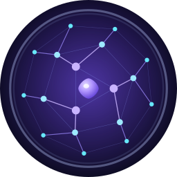

<div align="center">



# NeoCosmos · 个人版

**关系优先的本地知识网络** — 让磁盘上的 Markdown 文件夹长成一张会联想、可追溯的知识网络；所有计算在本机完成，数据不上传云端。


[特性](#核心特性) · [快速开始](#快速开始) · [授权与许可](#授权与许可请先阅读) · [多协议声明](#多协议声明) · [支持项目](#支持项目) · [文档](#文档索引)

</div>

---

## 为什么是「关系优先」

多数知识工具以**文档/卡片为中心**：链接只是附属于节点的引用。NeoCosmos 把前提倒过来——

> **第一公民是「突触」（带类型、带权重、会强化、会衰减、可解释的关系边）；节点只是突触交汇处的暂态投影。**

由此带来四类只能内建、无法外挂为插件的能力：

| 能力 | 说明 |
| --- | --- |
| 关系自动生长 | 边来自语义、共现、时间、因果多通道；手写的 `[[双链]]` 只是权重最高的一类边 |
| 突触可塑性 | 边权重随「被使用」强化、随「被冷落」衰减，只弱化不删除记忆 |
| 激活扩散召回 | 检索从命中点向外联想，并返回可解释的推理链（因 A→B→C 故推荐 C） |
| 回写闭环与巩固 | 每次问答沉淀成卡片并入网；空闲时做消歧、补边、矛盾检测 |

## 核心特性

- **星图 / 地图**：突触式关系图谱，激活扩散检索与可解释联想；星位由卡片 ID 哈希决定，同一张卡在任何设备都落在同一位置。
- **本地知识库**：双链、卡片、标签、跨库关联；零内置内容，原始 `.md` 零改动。
- **认知内核**：突触可塑性、记忆巩固、自研 NeoLM 词向量模型与语义回流层（离线、可复现、可核验）。
- **沉淀回写**：问答结论沉淀为卡片并强化关系，可指定专属沉淀库。
- **MCP 服务**：stdio MCP Server，可接入 OpenClaw / WorkBuddy / AutoClaw / Claude Desktop 等宿主；外部调用跟随当前打开的库。
- **纯净离线**：零内置知识库、零云端调用、零第三方**运行时**依赖。

> **诚实边界**：界面中的类脑/成长架构是可解释的产品隐喻，不具备生命、意识或主观体验；数值内核为本机经典算法，非真实量子计算；所有输出不构成法律意见，仅供研究参考。见 [合规与原创](docs/ORIGINALITY.md)。

## 快速开始

### 引擎与 CLI（Node.js ≥ 18）

```bash
npm test          # 引擎与契约测试
npm run mcp       # 启动 stdio MCP Server
npm run mcp:config # 打印宿主接入配置
npm run demo      # 本地演示
```

### 桌面客户端（Electron）

个人版安装包在项目的 Releases 页单独分发（见 [PUBLIC-RELEASE.md](PUBLIC-RELEASE.md)）。从源码构建见 `tools/stage-app.mjs`（个人版编排；企业版构建脚本不在本仓库）。

大体积资产（NeoLM 权重约 1.5 GiB、字体、环境贴图）受仓库体积限制不随源码分发，可用 `tools/` 下的训练/生成脚本按真实语料复现；缺失时引擎如实降级，不填充假数据。

## 授权与许可（请先阅读）

本项目采用**双轨授权（Dual Licensing）**。请务必分清两条轨道——这不是「二选一」，而是「按你的使用方式决定」：

| 轨道 | 许可 | 适用 | 核心义务 |
| --- | --- | --- | --- |
| **开源轨道** | [AGPL-3.0](legal/AGPL-3.0.txt) | 个人、学习、研究、教学、家庭、内网自用，以及**任何愿意履行开源义务的使用（含商业使用）** | 分发修改版须以 AGPL-3.0 开源对应源码；修改后通过网络对外提供服务，须向网络用户提供修改版完整源码（第 13 条） |
| **商业轨道** | [专有商业许可](legal/COMMERCIAL-LICENSE.md) | 不愿履行上述开源义务的场景：闭源集成、专有产品分发、SaaS 不提供源码、需要授权书或商业支持 | 按双方书面约定取得授权，不受 copyleft 约束 |

### 关键说明（合规要点）

- **AGPL-3.0 是真正的开源许可**：它**允许**任何用途，包括商业用途。开源许可不得歧视使用领域，因此开源轨道不对「商业使用」设限。
- **「强制开源」体现在 copyleft**：一旦你分发修改版或将其作为网络服务提供，就必须公开对应源码——这就是 AGPL 区别于普通 MIT 的地方，也是本项目保护开放性、防止私有化的机制。
- **何时需要商业授权**：当你的场景**无法或不愿履行开源义务**（例如要闭源集成、或以 SaaS 形式提供服务而不向用户公开源码），才需要取得商业许可。这不是对「商业使用」收费，而是为「不开源」提供一条合法路径。
- 未经商业授权而闭源使用或分发，将构成对 AGPL-3.0 的违反。

**商用授权请联系开发者：宋锦涛 · 13869162267**，详见 [legal/COMMERCIAL-LICENSE.md](legal/COMMERCIAL-LICENSE.md)。

企业版为专有商用许可，其专有构建产物不在本仓库分发；与本版共用的源码模块按 AGPL-3.0 一并开源。

## 多协议声明

本项目按内容类型采用不同开源许可，完整清单见 [LICENSES.md](LICENSES.md)：

| 内容 | 许可 | SPDX |
| --- | --- | --- |
| 自研源码（`src/`、`desktop/`、`tools/`、`test/`） | GNU Affero General Public License v3.0 或更高版本 | `AGPL-3.0-or-later` |
| 项目文档（`docs/`、`*.md`） | Creative Commons 署名-相同方式共享 4.0 | `CC-BY-SA-4.0` |
| 第三方 JS 组件（Electron、three.js、resedit、pe-library、pinyin-pro） | MIT | `MIT` |
| 中文字体（思源黑体 / 思源宋体，MS Gothic 风格手写体） | SIL Open Font License 1.1 | `OFL-1.1` |
| 安装包编译工具（NSIS 3.10，仅构建期） | zlib/libpng | `zlib` |

许可证全文位于 [`legal/`](legal/) 与 `desktop/assets/fonts/`。第三方组件清单、版权声明与许可证位置见 [LICENSES.md](LICENSES.md) 与 [NOTICE](NOTICE)。

## 知识产权保护

- **版权**：© 2026 宋锦涛。源码按 AGPL-3.0 开放，但版权与署名权始终保留。
- **商标**：`NeoCosmos`、`NeoLink`、`NeoLM` 及本项目品牌标识为开发者所有。开源许可**不授予**使用这些名称、商标或品牌进行背书宣传的权利；商标使用须另行书面授权。见 [NOTICE](NOTICE)。
- **原创性**：图标、Logo、环境贴图均为数学程序原创生成（脚本见 `tools/make-icon.mjs`、`tools/gen-*-assets.mjs`）；坚持净室开发，不复刻任何第三方产品的代码、界面、图标或文案。见 [原创性声明](docs/ORIGINALITY.md)。
- **贡献**：提交 PR 即表示你有权贡献该内容，并同意其内容按 AGPL-3.0 开源。见 [CONTRIBUTING.md](CONTRIBUTING.md)。

## 开发者与联系

- **开发者**：宋锦涛
- **联系方式**：13869162267
- **商用授权**：同上联系方式，详见 [商业许可说明](legal/COMMERCIAL-LICENSE.md)
- **安全漏洞**：请按 [SECURITY.md](SECURITY.md) 私下报告，勿公开 issue

## 支持项目

如果 NeoCosmos 对你有帮助，欢迎**自愿**鼓励开发者贡献：


> 扫码为微信支付收款码，金额自定、完全自愿。捐赠**不构成**任何商业授权、不购买任何功能、也不影响软件的开源许可条款。若你需要闭源商用或商业支持，请走 [商业授权](legal/COMMERCIAL-LICENSE.md) 渠道。

## 隐私与数据

知识库是磁盘上的普通 Markdown 文件夹，始终归你所有；软件在本机读取、检索、计算，不上传任何云端，开发者不访问你的知识库内容。连接日志只记路径与去重来源，不记令牌或正文。详见 [PRIVACY.md](PRIVACY.md)。

## 文档索引

| 文档 | 内容 |
| --- | --- |
| [核心概念](docs/spec/00-concept.md) | 关系优先的定义与结构倒置 |
| [架构](docs/spec/01-architecture.md) | 模块分层与数据流 |
| [机制](docs/spec/02-mechanisms.md) | 突触动力学、扩散、巩固 |
| [产品](docs/spec/03-product.md) | 交付形态与能力边界 |
| [工作区](docs/spec/04-workspace.md) | 知识库与沉淀区组织 |
| [MCP 接入](docs/MCP-OPENCLAW.md) | 宿主配置与工具清单 |
| [变更日志](CHANGELOG.md) | 公开版本记录 |
| [原创性声明](docs/ORIGINALITY.md) | 净室开发与红线 |
| [贡献指南](CONTRIBUTING.md) | 开发、测试、PR 流程 |
| [安全策略](SECURITY.md) | 漏洞报告流程 |
| [行为准则](CODE_OF_CONDUCT.md) | 社区参与规范 |
| [隐私声明](PRIVACY.md) | 数据处理说明 |
| [许可清单](LICENSES.md) | 多协议与第三方声明 |

## 目录结构

```
src/        引擎内核（存储 / 检索 / 认知 / MCP / 可视化导出）
desktop/    Electron 桌面壳与 UI
docs/       规格、机制、行为准则等文档
legal/      许可证全文、EULA、商业授权说明
tools/      构建 / 编排 / 门禁脚本（不含签名私钥）
test/       契约测试与引擎测试
```

---

<div align="center">

以 AGPL-3.0 开源 · 商用请取得授权 · © 2026 宋锦涛

</div>
